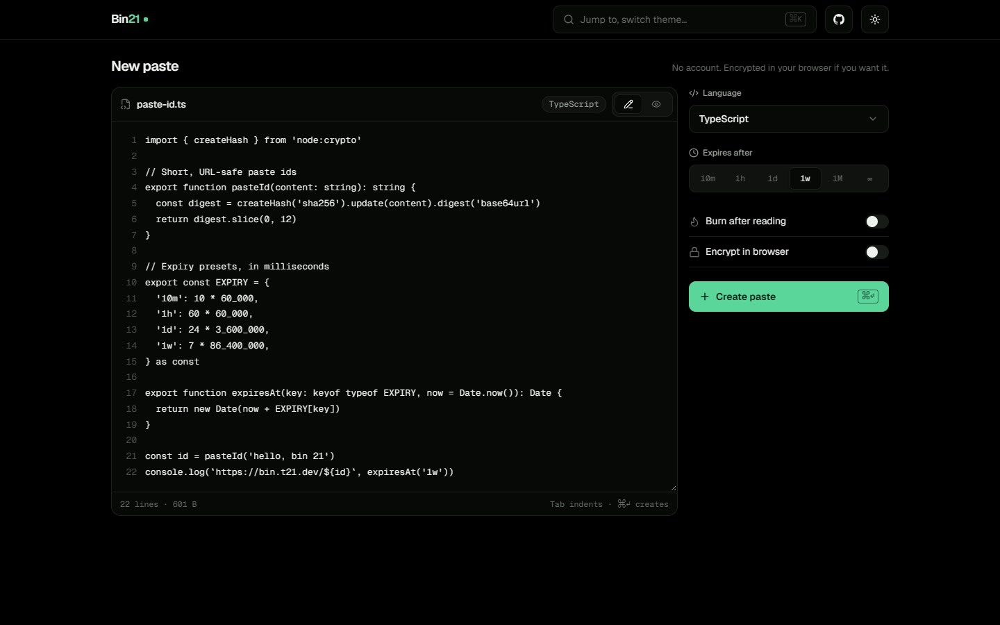
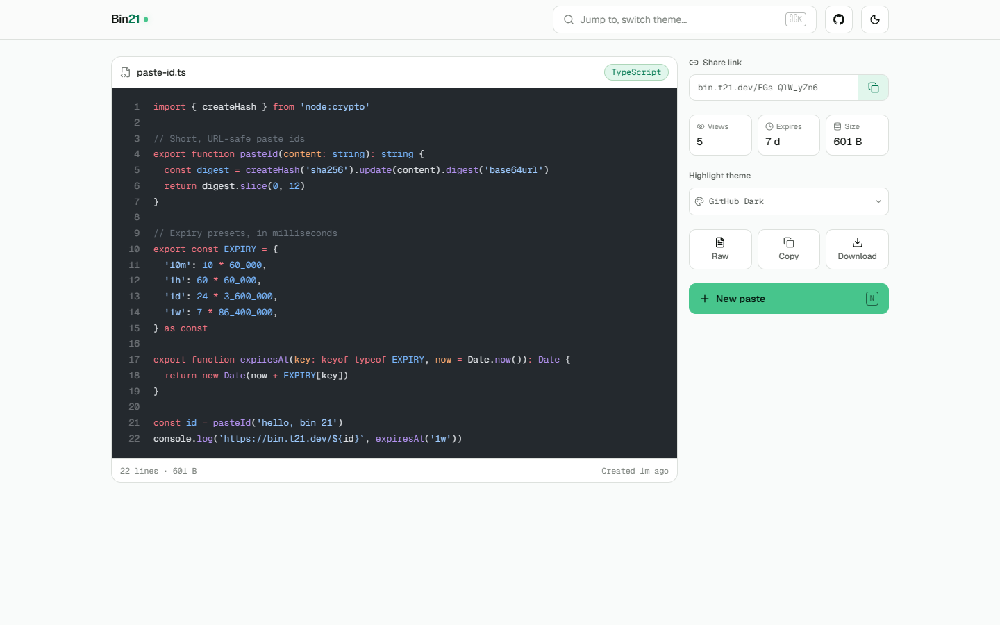
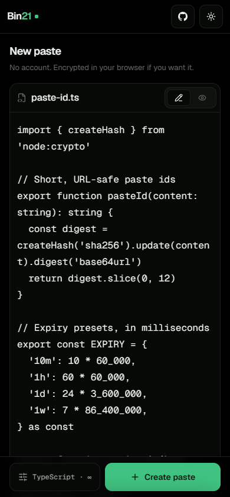
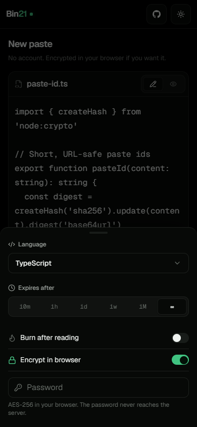
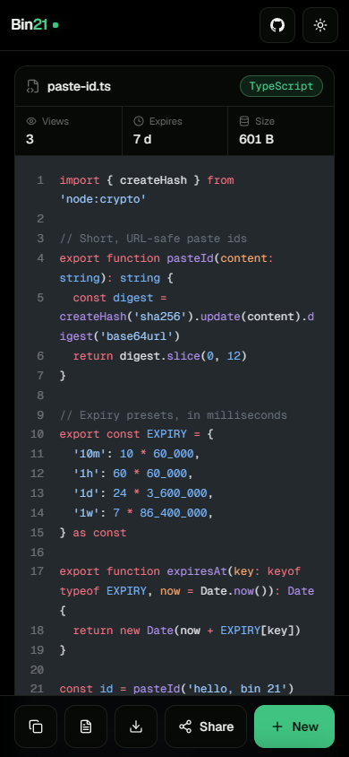
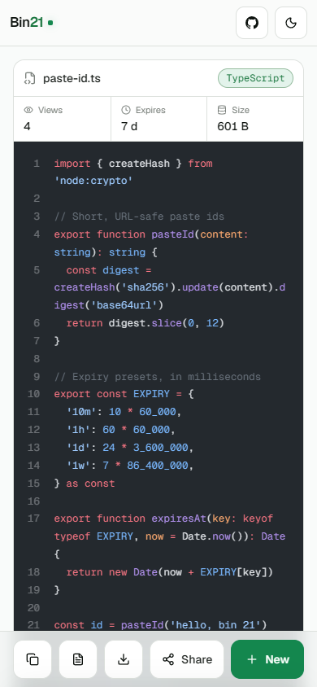

<p align="center">
  
</p>

<h3 align="center">Modern No-Strings-Attached Pastebin</h3>

<p align="center">
  Share code and text instantly. No account required. Privacy-first.
</p>

<p align="center">
  <a href="https://github.com/t21dev/bin-21/blob/main/LICENSE"></a>
  <a href="https://github.com/t21dev/bin-21"></a>
  
  
</p>

---

## Screenshots

<p align="center">
  
</p>

<p align="center">
  
</p>

<p align="center">
  
  
  
  
</p>

## Features

- **150+ Languages** - Syntax highlighting powered by Shiki (same engine as VS Code)
- **Markdown Rendering** - Full GitHub Flavored Markdown with code blocks
- **Client-Side Encryption** - AES-256-GCM encryption. Your password never leaves the browser
- **Burn After Reading** - Self-destructing pastes after first view
- **Expiration Options** - Never, 10 min, 1 hour, 1 day, 1 week, 1 month
- **Zero Authentication** - No account, no email, no friction
- **Dark Mode** - Pure black OLED-optimized dark theme, with a matching light theme
- **Mobile-first** - Options in a bottom sheet, actions in a sticky thumb-reach dock, code that wraps instead of scrolling sideways
- **Keyboard-friendly** - ⌘↵ to create, N for a new paste
- **Fast navigation** - Hover preloading, skeleton loaders, a route progress bar and native View Transitions
- **Bot Protection** - Honeypot fields, time-based detection, JS challenges
- **Rate Limiting** - In-memory sliding window rate limiter
- **Admin Analytics** - Optional `/admin` dashboard (paste/view totals, language mix, size distribution, activity over time). Disabled unless `ADMIN_TOKEN` is set
- **Open Source** - MIT licensed. Self-host it, fork it, contribute to it

## Tech Stack

| Layer | Technology |
|-------|-----------|
| Framework | [TanStack Start](https://tanstack.com/start) (file routes, server functions, request middleware) on Vite + Nitro |
| Language | TypeScript 5 (strict mode) |
| Styling | Tailwind CSS 4, Geist + Geist Mono, [Lucide](https://lucide.dev) icons |
| Database | SQLite via [Drizzle ORM](https://orm.drizzle.team) + [better-sqlite3](https://github.com/WiseLibs/better-sqlite3) |
| Object Storage | [Cloudflare R2](https://developers.cloudflare.com/r2/) (S3-compatible) |
| Syntax Highlighting | [Shiki](https://shiki.style) (150+ languages) |
| Markdown | [React Markdown](https://github.com/remarkjs/react-markdown) + remark-gfm |
| Encryption | Web Crypto API (AES-256-GCM + PBKDF2) |
| Rate Limiting | In-memory sliding window (single-instance by design) |
| Charts | [Recharts](https://recharts.org) + [Evil Charts](https://evilcharts.com) (admin analytics) |
| Validation | [Zod](https://zod.dev) |
| Deployment | [Railway](https://railway.com) — one service + a volume |

## Architecture

```
bin-21/
  src/
    routes/               # File routes: /, /$id, /$id/raw, /admin, OG images, manifest
    router.tsx            # Router (preloading, pending UI, view transitions)
    start.ts              # Request middleware (rate limiting, admin gate)
    server.ts             # Server entry (opens the DB, starts the janitor)
    styles.css            # Design tokens + component styles
  server/
    actions/              # Server functions (entry points, Zod validation)
    services/             # Core business logic (DB, R2, stats)
  lib/
    db/                   # Drizzle schema, SQLite client, migrations
    shiki.ts              # Syntax highlighter (JS regex engine, bounded caches)
    lru.ts                # Byte-capped LRU used for content + highlight caches
    languages.ts          # 150+ language definitions
    rate-limit.ts         # In-memory rate limiter
    janitor.ts            # Reclaims expired pastes
    admin-auth.ts         # Admin token verification
    bot-detection.ts      # Bot detection utilities
  components/
    ui/                   # Vendored chart primitives
    admin/                # Analytics dashboard components
  types/                  # Shared TypeScript types
```

**Data flow:** Client form -> server function (validates with Zod) -> Service (uploads content to R2, saves metadata to SQLite) -> Returns paste ID -> Redirect to view page.

Paste content is stored in Cloudflare R2, never in the database. Encrypted pastes use client-side AES-256-GCM - the password never reaches the server.

**Single-instance by design.** The SQLite file lives on a mounted volume, and Railway does not allow replicas on a service with a volume. That is what makes in-memory rate limiting and the in-process janitor correct. The trade-offs: no horizontal scaling, and brief downtime on redeploy.

## Getting Started

### Prerequisites

- Node.js 20+
- Cloudflare R2 bucket

No database server to run — SQLite is a file, created automatically on first boot.

### Setup

```bash
git clone https://github.com/t21dev/bin-21.git
cd bin-21
npm install
cp .env.example .env
```

Edit `.env` with your credentials:

```env
# Optional locally — defaults to ./.data/bin21.db
DATABASE_PATH=./.data/bin21.db
R2_ACCOUNT_ID=your-account-id
R2_ACCESS_KEY_ID=your-access-key
R2_SECRET_ACCESS_KEY=your-secret-key
R2_BUCKET_NAME=bin21-pastes
NEXT_PUBLIC_APP_URL=http://localhost:3000
```

Start the dev server — migrations run automatically on boot:

```bash
npm run dev
```

Open [http://localhost:3000](http://localhost:3000).

> Leave `JANITOR_ENABLED` unset locally. It deletes expired pastes **and their R2 objects**, so a dev machine pointed at a production bucket would reclaim live storage.

### Commands

```bash
npm run dev          # Start dev server
npm run build        # Production build
npm start            # Start production server (node .output/server/index.mjs, 192MB heap cap)
npm run lint         # ESLint
npm run db:push      # Push schema to database
npm run db:generate  # Generate Drizzle migrations
npm run db:studio    # Open Drizzle Studio
```

## Deployment

> **Self-hosting?** See the full [Self-Hosting Guide](SELF-HOSTING.md) for Docker Compose, MinIO, reverse proxy, and more.

### Railway (Recommended)

1. Create a new project on [Railway](https://railway.com)
2. Connect your GitHub repo
3. Attach a **volume** to the service, mounted at `/data`
4. Set environment variables from `.env.example` — in particular `DATABASE_PATH=/data/bin21.db` and `JANITOR_ENABLED=true`
5. Enable **automated volume backups**. The volume is now the only copy of your paste metadata; there is no managed database to fall back on
6. Deploy

No database or cache service is needed — one service plus a volume.

### Docker

```dockerfile
FROM node:20-alpine AS base
WORKDIR /app

FROM base AS deps
COPY package*.json ./
RUN npm ci

FROM base AS builder
COPY --from=deps /app/node_modules ./node_modules
COPY . .
RUN npm run build

FROM base AS runner
ENV NODE_ENV=production
# .output is self-contained: server bundle, traced node_modules, public assets
COPY --from=builder /app/.output ./.output
COPY --from=builder /app/lib/db/migrations ./lib/db/migrations
EXPOSE 3000
CMD ["node", "--max-old-space-size=192", ".output/server/index.mjs"]
```

## Privacy & Security

- **Client-side encryption**: Password-protected pastes are encrypted in your browser using AES-256-GCM with PBKDF2 key derivation (100,000 iterations). The plaintext password never reaches the server.
- **No tracking**: No analytics, no cookies (beyond theme preference), no user accounts.
- **IP hashing**: IPs are salted and hashed for rate limiting. Raw IPs are never stored.
- **Burn after reading**: Paste is permanently deleted from both database and R2 after first view.
- **Expiration**: Expired pastes are automatically cleaned up.

## Rate Limits

| Action | Limit | Window |
|--------|-------|--------|
| Create paste | 10 requests | 1 minute |
| View paste | 60 requests | 1 minute |
| Failed password | 5 attempts | 5 minutes |

## Contributing

Contributions are welcome. Please open an issue first to discuss what you'd like to change.

1. Fork the repo
2. Create your branch (`git checkout -b feature/my-feature`)
3. Commit your changes
4. Push to the branch
5. Open a Pull Request

## License

[MIT](LICENSE) - do whatever you want with it.

---

<p align="center">
  Built by <a href="https://github.com/t21dev">T21 Dev</a>
</p>
